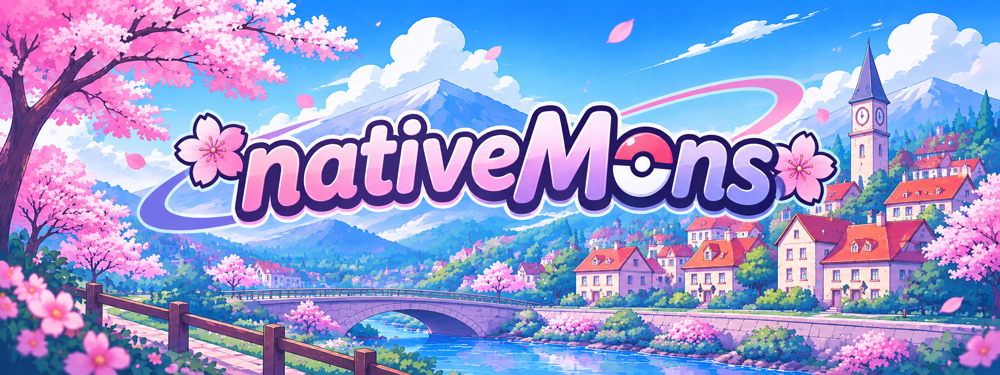

One launcher for native Pokémon ports on Windows, with a menu for controller, keyboard and mouse. It starts each game
through its own engine, and the engines stay forks that keep pulling their upstream updates. The 3DS games play natively
with 3DSrecomp+Zakuro, built once on your PC from your own dump, or through an optional 3DS emulator, each from our own fork. It also installs and runs the fan game Pokémon Infinite Fusion, and
any other self-contained PC game you add.

No games are included: you need your own ROMs. Not affiliated with or endorsed by Nintendo, Creatures Inc.,
GAME FREAK inc. or The Pokémon Company.

## Supported games

Each game starts with the first engine listed; its page switches to another.

### Generations 1 to 5

| Gen | Games | Engines |
|:-:|---|---|
| 1 | Red, Blue, Yellow | Gen1Recomp |
| 2 | Gold, Silver, Crystal | Gen1Recomp |
| 3 | Ruby, Sapphire | Gen1Recomp |
| 3 | FireRed, LeafGreen, Emerald | Fulldex, Gen1Recomp |
| 4 | Diamond, Pearl | nativeplat |
| 4 | HeartGold, SoulSilver | Fulldex |
| 4 | Platinum | Fulldex, Platinum PC port, nativeplat |
| 5 | Black, White, Black 2, White 2 | Fulldex |

### Generations 6 and 7 (3DS)

| Gen | Games | Engines |
|:-:|---|---|
| 6 | X, Y, Omega Ruby, Alpha Sapphire | **3DSrecomp+Zakuro** (recommended), 3DS emulator |
| 7 | Sun, Moon, Ultra Sun, Ultra Moon | **3DSrecomp+Zakuro** (recommended), 3DS emulator |

Plus **[Pokémon Infinite Fusion](docs/pc-games.md#pokémon-infinite-fusion-and-infinite-fusion-2)**, a PC fan game with no ROM, which the launcher installs and runs as its own program.

**3DS games** play best natively with [3DSrecomp+Zakuro](docs/3ds.md#3dsrecompzakuro), recommended over emulation: it runs more smoothly, and each game is built once on your PC from your own dump. A [3DS emulator](docs/3ds.md) is the fallback, for encrypted dumps: AzaharPlus (recommended of the two) or Azahar, installed from the launcher only if you want them. Switch games aren't supported.

Windows only for now. Each engine accepts certain versions of a ROM, mostly the US release, and the launcher tells you if yours isn't one: [Games and ROMs](docs/games-and-roms.md) has the details, several versions of one game, and ROM hacks.

## Get started

**Which download?**
- **[Stable](https://github.com/Hailey-Ross/nativeMons/releases/tag/stable)** (recommended): the latest build that's been checked. Stable has a version number, such as 0.0.5, raised for notable changes; each numbered release stays on the releases page. Minor updates, such as engine updates, keep the number. [CHANGELOG.md](CHANGELOG.md) lists what each one changed.
- **[Dev](https://github.com/Hailey-Ross/nativeMons/releases/tag/bleeding-edge):** the newest changes, built from every commit to `dev`. It may be broken, so back up your saves.

**What you need:** a Windows 10 or 11 PC, and your own Pokémon game files (ROMs). No games come with nativeMons.

1. **Download** the zip: on the release page, click **Download Windows ZIP**.
2. **Unzip it.** Right-click the downloaded file and choose **Extract All...**, then **Extract**. Put the folder somewhere easy to find, such as your Documents or Desktop (not inside Program Files).
3. **Open it.** In the new folder, double-click **NativeMonsLauncher**.
   - If Windows shows **"Windows protected your PC"**, click **More info**, then **Run anyway**. This appears because nativeMons is a free project without a paid signing certificate.
4. **Add your games.** The first time, nativeMons walks you through a short setup: choose **Add a folder** and pick the folder your game files are in. Or just drag that folder onto the nativeMons window. Later, more folders go in under **ROMs**.
   - It finds Game Boy, Game Boy Color, Game Boy Advance and DS games (`.gb`, `.gbc`, `.gba`, `.nds`, and `.zip` files holding them), and 3DS games (`.3ds`, `.cci`). The file names don't matter: games are found by reading each ROM.
   - For 3DS games, also turn on **3DS games** under **Emu** and install an emulator there (see [3DS games](docs/3ds.md)).
5. **Wait about a minute the first time.** nativeMons gets your games ready behind its loading screen. After that it opens in about a second.
6. **Play.** Choose **Games**, pick a game, and press **Play**.

**Already have saves from another emulator?** Choose **Settings**, then **Import saves**. Your original save files aren't changed.

**A DS game that won't start?** Some DS ROMs need a small fix first (their secure area decrypted). nativeMons offers it when it finds one. The fix needs Python 3: if your PC has none, nativeMons can fetch Python's official Windows package from python.org into its own `tools\python` folder (nothing is installed in Windows).

## Guides

| Guide | What's in it |
|---|---|
| [Using the launcher](docs/using-the-launcher.md) | Moving around, adding games by dropping files, shortcuts, the first start |
| [Games and ROMs](docs/games-and-roms.md) | Accepted dumps for each engine, several versions of a game, ROM hacks |
| [3DS games](docs/3ds.md) | 3DSrecomp+Zakuro and the optional emulators |
| [PC games](docs/pc-games.md) | Pokémon Infinite Fusion and Infinite Fusion 2, and other PC games |
| [Saves](docs/saves.md) | Save slots, import and export, one save across engines, backups |
| [My Collection and Move Pokemon](docs/pokemon.md) | Your Pokédex across games, and moving Pokémon between them |
| [Mods](docs/mods.md) | Gen1Recomp mods: installing, finding, mods that need or clash with others |
| [Settings](docs/settings.md) | Game options, quick start, Discord, updates, controls |
| [Engines](docs/engines.md) | nativeplat, the Platinum PC port, and everything nativeMons is built from |
| [Building from source](docs/building.md) | Building it yourself, and the pre-release check |

Every change is listed in [CHANGELOG.md](CHANGELOG.md).

## Credits

Parts of Gen1Recomp inspired this project and helped with research along the way. For the Gen1Recomp engine included here: Based on the Pokemon Gen 1 Recompilation Project by BOIS CLUB GAMES, LLC (https://github.com/bryanthaboi/gen1recomp).

- [Pokémon Fulldex](https://github.com/mamesj/pokemon-fulldex) by mamesj, a fork of [ssrecomp](https://github.com/ClickingMaster/ssrecomp) by ClickingMaster, using [melonDS](https://github.com/melonDS-emu/melonDS) and [mGBA](https://github.com/mgba-emu/mgba).
- [nativeplat](https://github.com/sohamb117/gen4recomp) by sohamb117, from the pret decompilations. Not affiliated with nativeMons.
- [Pokémon Platinum PC port](https://github.com/cybervisi0n/pokeplatinum) by cybervisi0n and contributors, using [libntr](https://github.com/cybervisi0n/libntr) (MIT), from the [pret](https://github.com/pret/pokeplatinum) decompilation. They aren't affiliated with nativeMons.
- [Pokémon Infinite Fusion](https://github.com/infinitefusion/infinitefusion-e18) by chardub (Frogman) and its contributors, made with Pokémon Essentials; its custom fusion sprites are by the Infinite Fusion artist community. Not included: imported from your own copy or its GitHub, or run from your own installation. Not affiliated with nativeMons.
- [PKHeX.Core](https://github.com/kwsch/PKHeX) by Kaphotics and contributors.
- [mGBA](https://github.com/mgba-emu/mgba) by endrift and contributors (MPL-2.0), in the GBA player with our widescreen change, and as its [libretro](https://www.libretro.com) core for romhacks' title screens.
- Pokemon GBA Widescreen by mamesj (in Pokémon Fulldex), whose idea and game protocol the GBA player follows; its widescreen patches are our own, written from the [pret](https://github.com/pret) decompilations' names.
- Widescreen for romhacks and other versions in the GBA player: PokeDaisy's EXPAND (GPL-3.0), unchanged. Based on PokeDaisy by Lidor Itzhari - https://github.com/lidor30/pokedaisy
- [Python](https://www.python.org) by the Python Software Foundation (PSF License), fetched from python.org only when you patch a ROM and have no Python 3.
- [rcheevos](https://github.com/RetroAchievements/rcheevos) by the RetroAchievements team (MIT), for RetroAchievements in the GBA player, through Pokémon Fulldex's achievements code.
- [OpenHome](https://github.com/andrewbenington/OpenHome) by Andrew Benington (GPL-3.0), running on [Node.js](https://nodejs.org).
- [LÖVE](https://github.com/love2d/love), which runs Gen1Recomp.
- [Zakuro](https://github.com/fearkov/zakuro) and [3dsrecomp](https://github.com/fearkov/3dsrecomp) by fearkov (both MIT), for 3DSrecomp+Zakuro, built from our fork ([Hailey-Ross/zakuro](https://github.com/Hailey-Ross/zakuro)) with a small tool of ours that builds a game's code without a window. [Zig](https://ziglang.org) (MIT), the C compiler, is fetched from ziglang.org for the first build. They aren't affiliated with nativeMons.
- Optional 3DS emulators, downloaded only when you choose one, each built from our fork with small changes for nativeMons (the source of each build is on its release): [Azahar](https://github.com/azahar-emu/azahar) by the Azahar team, from Citra (GPL-2.0-or-later; our fork: [Hailey-Ross/azahar](https://github.com/Hailey-Ross/azahar)); [AzaharPlus](https://github.com/AzaharPlus/AzaharPlus) by its contributors, from Azahar (GPL-3.0; ours, without its system-file downloader: [Hailey-Ross/AzaharPlus](https://github.com/Hailey-Ross/AzaharPlus)). Shown as "Azahar-modified (nativeMons)" and so on; they aren't the official builds, and their authors aren't affiliated with nativeMons.
- The [Gen1Recomp community mod index](https://github.com/bryanthaboi/gen1recomp-mod-index), read for **Find mods**. Its listings are by the mods' authors; the mods are theirs.
- [hails.nds-Patcher](https://github.com/Hailey-Ross/hails.nds-Patcher) by Hails.
- Pokédex entries from [PokéAPI](https://pokeapi.co).
- Pokémon pictures served by [hailsDotGO](https://github.com/Hailey-Ross/hailsDotGO) at pogo.hails.app, from the [PokeAPI sprites](https://github.com/PokeAPI/sprites) collection. The busy Poké Ball is after its "Updating" page.
- Launcher design from the Skate 3 Rust Engine's [hails-additions](https://github.com/Hailey-Ross/rusty-trucks/tree/hails-additions) branch.

Not affiliated with or endorsed by Nintendo, Creatures Inc., GAME FREAK inc. or The Pokémon Company. Pokémon and all related names belong to their owners.

## License

GPL-3.0-or-later (see `LICENSE`). Each engine keeps its own license and credits, including the additional terms in
Gen1Recomp's `LICENSE.MD`.
