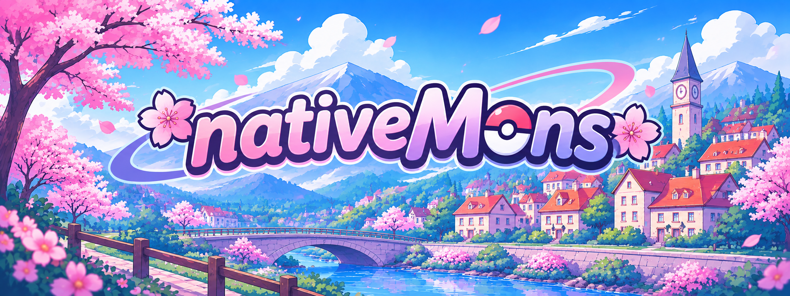
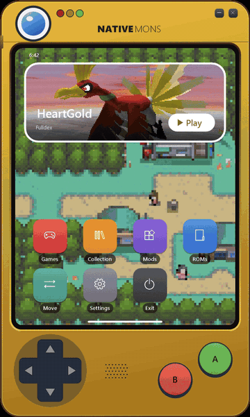

One launcher for native Pokémon ports on Windows, with a menu for controller, keyboard and mouse. It starts each game
through its own engine, and the engines stay forks that keep pulling their upstream updates. It also installs and runs
the fan game Pokémon Infinite Fusion, and any other self-contained PC game you add.

No games are included: you need your own ROMs. Not affiliated with or endorsed by Nintendo, Creatures Inc.,
GAME FREAK inc. or The Pokémon Company.

## Supported games

| Generation | Game | Gen1Recomp | Fulldex | Platinum PC port | nativeplat |
|---|---|:-:|:-:|:-:|:-:|
| 1 | Red, Blue, Yellow | ✓ | | | |
| 2 | Gold, Silver, Crystal | ✓ | | | |
| 3 | Ruby, Sapphire | ✓ | | | |
| 3 | FireRed, LeafGreen, Emerald | ✓ | ✓ | | |
| 4 | Diamond, Pearl | | | | ✓ |
| 4 | HeartGold, SoulSilver | | ✓ | | |
| 4 | Platinum | | ✓ | ✓ | ✓ |
| 5 | Black, White, Black 2, White 2 | | ✓ | | |

Plus **[Pokémon Infinite Fusion](#pokémon-infinite-fusion)**, a PC fan game with no ROM, which the launcher installs and runs as its own program.

**Not supported yet:** Generation 6 and later (3DS and Switch games).

**Several copies of a game:** if your folders hold more than one version, such as Rev 0 and Rev 1, the game's page gets a **ROM version** row to choose between them.

**ROM hacks are games of their own.** A hack of a game Fulldex runs (FireRed, LeafGreen and Emerald; Platinum hacks the same way, not yet tried) gets its own place in **Games**, named after its file: `Pokemon_FireRed_Rocket_Edition.gba` shows as "Pokemon FireRed Rocket Edition". **Rename** on its page changes that, and the name stays even if the file is renamed. Whether a ROM is a hack is decided by its contents only: it carries the game's code but isn't one of that game's clean dumps (every clean revision is known). The file name only gives it its name, so a clean copy under any file name stays with its game. It runs on Fulldex only, with saves, backups and save slots of its own, and its saves read as the base game's do, for **Move Pokemon**, **My Collection** and PKHeX. Widescreen depends on the hack. Tested: [Pokémon Rocket Edition](https://rocket-edition.com/) FINAL v1.0.2, a FireRed hack, which opens straight into the game and plays with no graphical issues.

Where a game has more than one engine it starts in Fulldex, and you can switch on its page. Each engine accepts certain versions of a ROM, mostly the US release: the launcher tells you if yours isn't one. Windows only for now.

## Accepted ROMs

Gen1Recomp and nativeplat only run exact dumps, so they check each ROM's SHA-1. If yours is refused, the game's page shows the hash it found.

| Game | Engine | Accepted SHA-1 |
|---|---|---|
| Red | Gen1Recomp | `ea9bcae617fdf159b045185467ae58b2e4a48b9a` |
| Blue | Gen1Recomp | `d7037c83e1ae5b39bde3c30787637ba1d4c48ce2` |
| Yellow | Gen1Recomp | `cc7d03262ebfaf2f06772c1a480c7d9d5f4a38e1` |
| Gold | Gen1Recomp | `d8b8a3600a465308c9953dfa04f0081c05bdcb94` |
| Silver | Gen1Recomp | `49b163f7e57702bc939d642a18f591de55d92dae` |
| Crystal | Gen1Recomp | `f4cd194bdee0d04ca4eac29e09b8e4e9d818c133` `f2f52230b536214ef7c9924f483392993e226cfb` |
| FireRed | Gen1Recomp | `41cb23d8dccc8ebd7c649cd8fbb58eeace6e2fdc` `dd5945db9b930750cb39d00c84da8571feebf417` |
| LeafGreen | Gen1Recomp | `574fa542ffebb14be69902d1d36f1ec0a4afd71e` `7862c67bdecbe21d1d69ce082ce34327e1c6ed5e` |
| Ruby | Gen1Recomp | `f28b6ffc97847e94a6c21a63cacf633ee5c8df1e` `610b96a9c9a7d03d2bafb655e7560ccff1a6d894` `5b64eacf892920518db4ec664e62a086dd5f5bc8` |
| Sapphire | Gen1Recomp | `3ccbbd45f8553c36463f13b938e833f652b793e4` `4722efb8cd45772ca32555b98fd3b9719f8e60a9` `89b45fb172e6b55d51fc0e61989775187f6fe63c` |
| Emerald | Gen1Recomp | `f3ae088181bf583e55daf962a92bb46f4f1d07b7` |
| Diamond | nativeplat | `a46233d8b79a69ea87aa295a0efad5237d02841e` |
| Pearl | nativeplat | `99083bf15ec7c6b81b4ba241ee10abd9e80999ac` |
| Platinum | nativeplat | `0862ec35b24de5c7e2dcb88c9eea0873110d755c` (Rev 1) `ce81046eda7d232513069519cb2085349896dec7` (Rev 0) |

Fulldex and the Platinum PC port don't check a hash: they go by the game code in the ROM's header, so most dumps of a supported game work.

Decrypt an encrypted DS ROM first: the launcher offers this when it finds one. nativeplat's own import screen refuses Platinum Rev 0, but nativeMons places the ROM itself. The two revisions share the same game files, differing only in a GTS screen, and Platinum runs nativeplat's Rev 1 code either way.

## Download

- **[Dev](https://github.com/Hailey-Ross/nativeMons/releases/tag/bleeding-edge):** built from every commit to `dev`. It may be broken, so back up your saves.
- **[Stable](https://github.com/Hailey-Ross/nativeMons/releases/tag/stable):** the latest working build, from `main`.

Unzip it anywhere (not inside Program Files), start `NativeMonsLauncher.exe` and add your ROM folder under **ROMs**, or drop the folder onto the window. File names don't matter: games are found by reading each ROM. Patching `.nds` ROMs needs Python 3.

**The first start** after adding ROMs takes about a minute behind the splash screen:
- Your Game Boy and GBA games are prepared for Gen1Recomp from your ROMs, three at a time.
- The game the menu opens on gets its title screen and town wallpaper; the other games' pictures are made in the background once the menu is up.

Everything runs out of sight at low priority. Windows Defender scans the many small files preparing writes, which is most of the load during that first start. After that the launcher opens in about a second.

Before a stable release, `tests/stable-check/stable-check.ps1` tests a release package on copies of your ROMs and saves. It runs in groups, so a failed part can be retested with `-Retest`; its header explains the options.

## Using it

The launcher is a phone-sized Pokédex that takes on each game's colours, and unfolds into a tablet for **Move**. Its home screen shows the game you played last: its intro plays in the **Play** tile, and one of its towns is the wallpaper, both captured from your own ROM on your PC. Below that are **Games**, **Collection**, **Mods**, **ROMs**, **Move**, **Settings** and **Exit**. Whenever the launcher is loading, a rainbow Poké Ball spins: on the splash at start, while it works on something such as preparing a game or backing up a save, while a game's title screen is being made in its Play tile, and while Pokémon pictures and Pokédex entries arrive.

- **D-pad or left stick:** move. **A:** select. **B:** back.
- **Keyboard:** arrow keys or WASD, Enter, Esc.
- **Mouse:** hover to select, click to choose, right-click to go back. The D-pad and buttons on the device can be clicked too, and dragging its shell moves the window.

**Dropping files on the window** works on any menu screen. A folder becomes a ROM folder. A `.gb`, `.gbc`, `.gba` or `.nds` ROM is used where it is, without its folder. A `.zip`'s ROMs are copied into `state\roms`, and the zip isn't changed. A `.sav` goes to Import saves. Afterwards a page says which game each ROM turned out to be. If a ROM isn't one nativeMons runs, the page says so and shows its SHA-1. **ROMs > Add a ROM file** does the same from a file picker. ROMs added on their own, and copies taken from a zip, are listed on the ROMs page, where you can remove them.

**Shortcuts:** `NativeMonsLauncher.exe --game <id>` starts a game and closes the launcher when the game ends. Ids are the lowercase names, such as `firered`, `crystal` or `black2`. Add `--slot <number or name>` to choose which of its saves to use, or `--launcher` to open the menu on that game's page instead. If the launcher is already open, it takes the request itself. `--play <id>` still works.

A game's page in **Games** has Play, its engine, ROM version, saves, game options, mods, backups, export and the PKHeX and OpenHome buttons.

## Pokémon Infinite Fusion

[Pokémon Infinite Fusion](https://github.com/infinitefusion/infinitefusion-e18) is a PC fan game (RPG Maker XP on mkxp-z), not a ROM. Open it in **Games** and choose one of two ways in; both are fine, and you can switch between them later:

- **Import it into the launcher.** From your installed folder, from the game's downloaded zip, or straight from its GitHub (that one needs [Git for Windows](https://git-scm.com)). The launcher keeps the game in `games\infinitefusion` and its saves in `state\saves\infinitefusion`, both inside the launcher's folder. Saves you already have in `%APPDATA%\infinitefusion` are copied in, and the originals stay. **Update** gets the newest release the way the game's own `INSTALL_OR_UPDATE` does. **Uninstall** removes the game's files and keeps its saves.
- **Add an existing installation.** The launcher runs your own copy where it is and never changes its files, and its saves stay where the game keeps them, in `%APPDATA%\infinitefusion`. Update it with the game's own updater. **Remove from the launcher** only forgets it.

Either way the launcher backs up the save files before each session (newest 30, under `state\save-backups`), and the game keeps backups of its own too. About 5 GB. Its Play tile and wallpaper come from the game's own title screen and region map. Move Pokémon, My Collection, quick start and the save tools don't apply to it.

## Other PC games

**Add a PC game**, at the end of **Games**, adds any self-contained game with its own program, such as another fan game, with nothing written for it. Three ways in:
- **From its folder:** point to where the game lives. It runs there, and nothing is copied.
- **From a .zip:** the launcher unpacks it into `games\` and keeps that copy. The zip stays as it is.
- **Choose its program (.exe):** then run it where it is, or let the launcher copy the game's folder into `games\`.

The launcher finds the game's program itself, leaving out installers and uninstallers, and asks which one when there's more than one. It's named after the program (rename it on its page) and gets a colour of its own.

These games go without the extras: no captured title screen or wallpaper, and no save handling, since the launcher can't know where such a game keeps its saves. The launcher starts the game, shows it on Discord, and waits for it to close; if the program only hands over to another one in its folder and quits, the session lasts until that one closes too. **Remove from the launcher** forgets it, and deletes the launcher's copy if it made one; your own folder and saves are never touched.

## Saves

**Several saves per game.** **Saves** on a game's page lets you keep as many saves as you like, each with a name of your choice. Switch between them, start a new one, copy or delete them. A switch keeps your current save exactly as it is, and the engines follow it.

**Bringing your saves.** **Settings > Import saves** finds `.sav` files in your ROM folders and any others you add, and works out their game by reading them. The originals aren't changed, and a save that gets replaced is backed up first.

**One save across engines.** FireRed, LeafGreen and Emerald can run on Gen1Recomp or Fulldex, and Platinum on Fulldex, nativeplat or the PC port. Each of these shares one save when your ROM works with the engines. Before and after each game the launcher brings them level:
- A verified backup comes first. Every save that's about to change is copied, and the copy is checked byte for byte.
- The result has to prove itself: its trainer, party, boxes, Pokédex and bag must match the source, or it's thrown away.
- If that fails, both saves stay as they were, the game still starts, and it tries again next time.
- If both saves changed, you choose which to keep. The other goes to your backups.

**Everything stays in the launcher's folder.** Saves, settings, mods and prepared games live beside `NativeMonsLauncher.exe`, in `state` and in each engine's folder, so the whole folder can move to another drive or PC. Gen1Recomp kept its own in `%APPDATA%\LOVE\nativemons` before; the first start of a newer launcher copies them into `state\gen1recomp`, checks every file, and leaves the old folder as it was, as a backup you can delete. If that copy can't finish, Gen1Recomp keeps using the old folder and the launcher tries again next time. Pokémon Infinite Fusion, when you add your existing installation, keeps its saves where the game puts them.

A game's page lists its **Save backups** to go back to. After each game the save is checked for corruption, and you're offered a healthy backup if it fails.

**Sending saves back.** **Settings > Export saves**, or a game's page, gives you:
- **A plain `.sav`** for emulators, flash carts and PKHeX.
- **3DS Virtual Console** (Game Boy and Game Boy Color): a Checkpoint folder holding `sav.dat`, copied byte for byte. Matching it to a Checkpoint backup of the game checks the size and copies its `SecureValue`.
- **3DS DS games:** needs a Checkpoint backup of the game, for the exact file name and size.

Only some of this has been tried on a real 3DS, so back up your 3DS save first.

## Pokémon

**My Collection** is a Pokédex built from all the saves of every game the launcher finds. It has a National list from 001 to 649, a list for each region from Kanto to Unova (by the generation that introduced each Pokémon), and your counts by game. Pokémon you haven't seen show as `???`. ROM hacks and fan games such as Infinite Fusion never count toward it: **Romhacks and fan games** lists them apart, each with a Pokédex of its own. Infinite Fusion's is read from its own saves: species caught and seen by National Dex number, later Pokémon than Unova counted beside them, and its fusions counted apart. The launcher only reads the game's species list and saves, and never changes them.

A caught Pokémon's entry shows its picture, category, types, height, weight, base stats, abilities and the description from a game you caught it in, plus each game that has it. A gold star marks a shiny, and A switches between its shiny and normal pictures. Shinies are counted only while they're in a party or a box, because saves keep no record of the rest.

Entries come from [PokéAPI](https://pokeapi.co) the first time you open them and are kept in `state\pokedex-cache`. No game text is included in nativeMons.

**Move Pokemon** shows your games' PC boxes the way Pokémon HOME does. The Pokédex unfolds into a tablet for it, smoothly, and folds back into the phone when you leave: two games side by side, each showing one box as a grid of its Pokémon. Drag a Pokémon onto an empty slot of the other game, or of another box in the same game (there it can also swap with one). With a controller or keyboard, A picks it up, A puts it down and B puts it back; left and right cross from one game's box into the other's at the edge. ◀ ▶ step through a game's boxes, and holding a dragged Pokémon over them turns the box too; selecting the game's name switches to another game. It uses [PKHeX.Core](https://github.com/kwsch/PKHeX), and both saves are backed up to `state\save-backups` first. If a move is blocked, you choose whether to delete or change the attacks in the way, then retry. A Pokémon that doesn't exist in the destination game can't go there. Only Pokémon in the PC boxes can be moved, not your party.

Moves with no real transfer between the games use the conversion code from [OpenHome](https://github.com/andrewbenington/OpenHome) (GPL-3.0), and PKHeX checks the result. The result may be flagged as not legal, and its form, ball and origin may change. The original data is kept and comes back when the Pokémon returns to its own generation. This part is experimental: try a moved Pokémon in battle before relying on it.

**Open in PKHeX** and **Open in OpenHome** on a game's page open its save in your own copy of either.

Pokémon pictures come from [pogo.hails.app](https://pogo.hails.app) ([hailsDotGO](https://github.com/Hailey-Ross/hailsDotGO)) and are kept in `state\sprite-cache`, refreshed after 30 days. The launcher fetches a Pokémon along with its whole evolution line, and works without them. **Settings > Download Pokedex** fetches every picture (Generations 1 to 5, normal and shiny) and every entry at once for offline play; run it again any time, it only fetches what's missing.

## Mods

**Mods** on the home screen, or on a Gen1Recomp game's page, installs and turns on mods for Gen1Recomp games. Choose a mod's `.zip` from any drive; installing a newer version over an old one keeps the old copy until the new one is in place. Mods only apply to games played on Gen1Recomp.

**Find mods** browses the [Gen1Recomp community mod index](https://github.com/bryanthaboi/gen1recomp-mod-index): the mods that fit the game, most downloaded first, each with its author, version, games, what it asks for (engine internals, files, going online) and whether it's experimental. **Install** downloads its release `.zip` from the author's own release and installs it as above; an installed mod shows **Installed** or **Update**. The index only lists mods: they're their authors' own code, and being listed isn't a check of them, so install only what you trust. A mod you install is switched on in each game it runs, unless it clashes there with one that's already on: then it stays off, and you choose. The examples that come with Gen1Recomp and need art imported from your own cartridge start switched off.

**Mods that need other mods.** A mod can name others it needs (`dependencies`) or can use (`optional_dependencies`) in its `manifest.json`. After any install, the launcher reads them by Gen1Recomp's own rules, versions and games included, and if one is missing or the wrong version, **Needs other mods** lists it. For each, you choose where it comes from: the mod index, its GitHub releases (when the mod names a repo), a `.zip` you downloaded, or a link to one. Whatever you choose has to hold that mod, or nothing is installed, and what it needs in turn is asked for next. An optional one can be declined, and isn't asked again. While anything is still missing, the game's Mods page shows **Missing mods**.

**Mods that clash.** A mod can name others it doesn't work with (`conflicts`, or `incompatible`), optionally for some versions only. While both are on, Gen1Recomp skips the mod that said so, without a word in the game, so the launcher says it instead: the Mods page shows **Clashes** while any pair is on together, and under each mod who it clashes with ("Won't load: clashes with ..."). Choose which to keep, or leave both on. Switching on a mod that clashes with one that's on asks first, and so does installing one. In **Find mods**, a mod's page lists what it clashes with, and says if you have one of them.

## Settings

Each engine has its own page of options (**Fulldex**, **Gen1Recomp**), stored where its menus keep them, so changes show up on both sides.

**Game options** set volume, music, sound effects, fullscreen, widescreen, smooth scaling, text speed, battle scene, battle style and sound for every game, and a game's own page can override them. Each one is left alone until you choose it, and it applies when a game starts. Not every engine has every setting: the page says which. Options kept in the save aren't available on Generation 5 yet.

**Quick start** opens games straight at their title screen, past the copyright and intro. On Gen1Recomp (Game Boy, Game Boy Color and GBA games) and nativeplat (Diamond, Pearl, Platinum), the last game you played waits at its title out of sight, silent and paused, while the menu is open, so Play shows it at once; it's used only if its save and options are still what it read. DS games on Fulldex start from a snapshot of their title screen, made in the background from a copy of your save; it's used only while your save is exactly the one it was made from, and the game's clock is set to now. Either is thrown away and made again whenever something it loaded could have changed. Turn it off to start games with their intro. GBA games on Fulldex, the Platinum PC port and Infinite Fusion start as before.

**Discord status** shows what you're playing while a game runs: "Playing nativeMons", the game and a timer, with a button others can use to find nativeMons on GitHub, through the Discord app on your PC. It clears when the game closes, and does nothing when Discord isn't open. Gen1Recomp's own Discord status is switched off for games the launcher starts, so only this one shows. Turn it off in Settings.

**Updates** checks this project's releases when the launcher starts and every 6 hours while it's open. When a new build is ready, a banner appears for a few seconds and Settings gets a badge; nothing downloads until you choose to. The same page switches between **Stable** and **Dev**. Updating replaces the launcher and every engine together from one checked download, and changes only the files that differ. Your saves, ROM copies, wallpapers, Pokédex data, settings and anything in `games\` stay as they are. A copy built from source reads as a local build, and any release counts as newer until you build again.

**Controls** lists the keys each engine uses while you play (Fulldex, Gen1Recomp, nativeplat, the Platinum PC port and Infinite Fusion): saving, fast forward, snapshots, screenshots and where to change them.

**Screenshots** opens the folders where nativeplat (F12) and Infinite Fusion (F8) put the screenshots you take. Fulldex and Gen1Recomp have no screenshot key; Windows + Shift + S works in any game.

**Import saves**, **Export saves**, **Download Pokedex**, **Credits** and **Last session** (how the last game ended) are here too.

## nativeplat

Diamond, Pearl and Platinum can run on [nativeplat](https://github.com/sohamb117/gen4recomp) by sohamb117, native ports from the pret decompilations. It's the only engine for Diamond and Pearl, and an option for Platinum under **Engine** on the game's page. Packages carry a Windows build made by [our fork's public workflow](https://github.com/Hailey-Ross/gen4recomp), program only: your ROM stays on your PC. Our fork adds the quick start mode. It shares one save with the other engines, checked each time it comes back. This is experimental, so keep a backup. nativeMons isn't affiliated with that project, so please report problems here first.

## Pokémon Platinum PC port

Platinum can also run on the native [PC port](https://github.com/cybervisi0n/pokeplatinum) by cybervisi0n and contributors, from the pret decompilation and [libntr](https://github.com/cybervisi0n/libntr). Choose it with **Engine** on the game's page. The download has only the program: the first start unpacks the game's files from your own ROM, on your PC. It shares one save with Fulldex, checked each time it comes back. This is experimental, so keep a backup. nativeMons isn't affiliated with that project, so please report problems here first.

## What it's built from

| Part | What it adds | Source |
|---|---|---|
| `engines/gen1recomp` | Red to Crystal, Ruby, Sapphire, FireRed, LeafGreen, Emerald, and mods. Its own launcher is removed, as its licence requires of forks; our fork adds quick start and keeps the launcher's background jobs out of sight | [bryanthaboi/gen1recomp](https://github.com/bryanthaboi/gen1recomp) |
| `engines/fulldex` | DS and GBA games in widescreen at 60 fps. Packages use its published Windows build | [mamesj/pokemon-fulldex](https://github.com/mamesj/pokemon-fulldex), a fork of [ClickingMaster/ssrecomp](https://github.com/ClickingMaster/ssrecomp), using melonDS and mGBA |
| GBA player (`engines/fulldex/gba`) | GBA games and hacks: FireRed, LeafGreen and Emerald in widescreen, everything else at 3:2. Ours, in our Fulldex fork; packages build it | [Hailey-Ross/pokemon-fulldex](https://github.com/Hailey-Ross/pokemon-fulldex/tree/hails-additions/gba), after Pokemon GBA Widescreen by mamesj |
| Platinum PC port | A native Platinum. Packages carry its published Windows release, program only | [cybervisi0n/pokeplatinum](https://github.com/cybervisi0n/pokeplatinum) |
| nativeplat | Native Diamond, Pearl and Platinum. Packages carry a build from our fork, program only | [sohamb117/gen4recomp](https://github.com/sohamb117/gen4recomp) |
| `tools/nds-patcher` | Decrypts `.nds` secure areas | [hails.nds-Patcher](https://github.com/Hailey-Ross/hails.nds-Patcher) |
| `tools/mon-bridge` | Reads saves and moves Pokémon | [PKHeX.Core](https://github.com/kwsch/PKHeX) by Kaphotics and contributors |
| `tools/openhome-bridge` | Converts Pokémon between games that have no real transfer | [OpenHome](https://github.com/andrewbenington/OpenHome) by Andrew Benington, run on Node.js |
| `launcher` | The menu | Window and input code from the steam launcher of [the Skate 3 Rust Engine's hails-additions branch](https://github.com/Hailey-Ross/rusty-trucks/tree/hails-additions) (SK8-ENGINE) |

Pokémon Infinite Fusion isn't part of a package: you import it or add your own installation.

## Build

Open `launcher\build.bat` to build everything into `build\nativeMons`, ready to run. It needs Git and the [.NET 10 SDK](https://dotnet.microsoft.com/download/dotnet/10.0), and downloads LÖVE, Fulldex's published Windows build, the Platinum PC port's and nativeplat's. With Node, Corepack and Rust too, it builds the OpenHome converter; without them, cross-generation moves use a simpler copy. To build somewhere else, put that folder's path in a `build-output.txt` at the repo root. Rebuilding keeps your settings, saves and `games\` folder.

`launcher\build.bat <output folder>` builds only the launcher and needs only Windows, but it can't run games without the engines. Beside the exe, `state\nativemons.cfg` can set the paths `love`, `gen1recomp`, `fulldex`, `pokeplatinum`, `nativeplat`, `infinitefusion`, `openhome`, `node`, `patcher` and `python`. Version colours and finishes live in `launcher\games.json`.

## Credits

Parts of Gen1Recomp inspired this project and helped with research along the way. For the Gen1Recomp engine included here: Based on the Pokemon Gen 1 Recompilation Project by BOIS CLUB GAMES, LLC (https://github.com/bryanthaboi/gen1recomp).

- [Pokémon Fulldex](https://github.com/mamesj/pokemon-fulldex) by mamesj, a fork of [ssrecomp](https://github.com/ClickingMaster/ssrecomp) by ClickingMaster, using [melonDS](https://github.com/melonDS-emu/melonDS) and [mGBA](https://github.com/mgba-emu/mgba).
- [nativeplat](https://github.com/sohamb117/gen4recomp) by sohamb117, from the pret decompilations. Not affiliated with nativeMons.
- [Pokémon Platinum PC port](https://github.com/cybervisi0n/pokeplatinum) by cybervisi0n and contributors, using [libntr](https://github.com/cybervisi0n/libntr) (MIT), from the [pret](https://github.com/pret/pokeplatinum) decompilation. They aren't affiliated with nativeMons.
- [Pokémon Infinite Fusion](https://github.com/infinitefusion/infinitefusion-e18) by chardub (Frogman) and its contributors, made with Pokémon Essentials; its custom fusion sprites are by the Infinite Fusion artist community. Not included: imported from your own copy or its GitHub, or run from your own installation. Not affiliated with nativeMons.
- [PKHeX.Core](https://github.com/kwsch/PKHeX) by Kaphotics and contributors.
- [mGBA](https://github.com/mgba-emu/mgba) by endrift and contributors (MPL-2.0), in the GBA player with our widescreen change, and as its [libretro](https://www.libretro.com) core for romhacks' title screens.
- Pokemon GBA Widescreen by mamesj (in Pokémon Fulldex), whose idea and game protocol the GBA player follows; its widescreen patches are our own, written from the [pret](https://github.com/pret) decompilations' names.
- [rcheevos](https://github.com/RetroAchievements/rcheevos) by the RetroAchievements team (MIT), for RetroAchievements in the GBA player, through Pokémon Fulldex's achievements code.
- [OpenHome](https://github.com/andrewbenington/OpenHome) by Andrew Benington (GPL-3.0), running on [Node.js](https://nodejs.org).
- [LÖVE](https://github.com/love2d/love), which runs Gen1Recomp.
- The [Gen1Recomp community mod index](https://github.com/bryanthaboi/gen1recomp-mod-index), read for **Find mods**. Its listings are by the mods' authors; the mods are theirs.
- [hails.nds-Patcher](https://github.com/Hailey-Ross/hails.nds-Patcher) by Hails.
- Pokédex entries from [PokéAPI](https://pokeapi.co).
- Pokémon pictures served by [hailsDotGO](https://github.com/Hailey-Ross/hailsDotGO) at pogo.hails.app, from the [PokeAPI sprites](https://github.com/PokeAPI/sprites) collection. The busy Poké Ball is after its "Updating" page.
- Launcher design from the Skate 3 Rust Engine's [hails-additions](https://github.com/Hailey-Ross/rusty-trucks/tree/hails-additions) branch.

Not affiliated with or endorsed by Nintendo, Creatures Inc., GAME FREAK inc. or The Pokémon Company. Pokémon and all related names belong to their owners.

## License

GPL-3.0-or-later (see `LICENSE`). Each engine keeps its own licence and credits, including the additional terms in
Gen1Recomp's `LICENSE.MD`.
