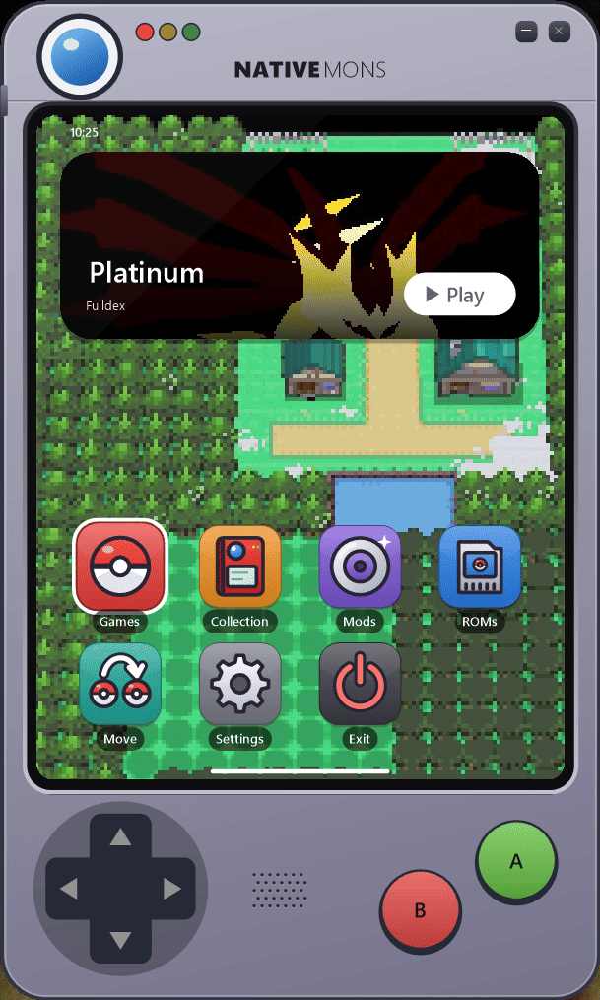

**nativeMons** is a Windows launcher for playing every Pokémon generation, from Red to Ultra Moon, as native PC
games. Pick a game from one menu with a controller, keyboard or mouse, and it starts on its own engine.

- **Native ports, not emulation.** Each game runs on a PC port of it. Every engine is a fork that keeps pulling its
  upstream updates.
- **3DS games too.** X to Ultra Moon run natively with 3DSrecomp+Zakuro, built once on your PC from your own
  cartridge dump. A 3DS emulator is there as an optional fallback.
- **Your saves, kept safe.** Each game's save is backed up before every session, checked after it, and shared by
  every engine that game can run on.
- **Your collection.** A Pokédex across all your games, and Pokémon moved between generations.
- **Fan games and more.** It installs Pokémon Infinite Fusion for you, and runs any other PC game you add.

You need your own game files (ROMs): no games come with nativeMons. Not affiliated with or endorsed by Nintendo,
Creatures Inc., GAME FREAK inc. or The Pokémon Company.

## Supported games

The first engine listed is the default; a game's page switches it to another.

### Generations 1 to 5

| Gen | Games | Engines |
|:-:|---|---|
| 1 | Red, Blue, Yellow | Gen1Recomp |
| 2 | Gold, Silver, Crystal | Gen1Recomp |
| 3 | Ruby, Sapphire | Gen1Recomp |
| 3 | FireRed, LeafGreen, Emerald | Fulldex, Gen1Recomp |
| 4 | Diamond, Pearl | nativeplat |
| 4 | HeartGold, SoulSilver | Fulldex |
| 4 | Platinum | Fulldex, Platinum PC port, nativeplat |
| 5 | Black, White, Black 2, White 2 | Fulldex |

### Generations 6 and 7 (3DS)

| Gen | Games | Engines |
|:-:|---|---|
| 6 | X, Y, Omega Ruby, Alpha Sapphire | **3DSrecomp+Zakuro** (recommended), 3DS emulator |
| 7 | Sun, Moon, Ultra Sun, Ultra Moon | **3DSrecomp+Zakuro** (recommended), 3DS emulator |

- **3DS games:** [3DSrecomp+Zakuro](docs/3ds.md#3dsrecompzakuro) plays them more smoothly than an emulator. An
  [emulator](docs/3ds.md) (AzaharPlus or Azahar, installed from the launcher if you want one) is the fallback, and
  AzaharPlus is the only way to play an encrypted dump.
- **Fan games:** [Pokémon Infinite Fusion and Infinite Fusion 2](docs/pc-games.md#pokémon-infinite-fusion-and-infinite-fusion-2)
  need no ROM: the launcher installs them.
- **Your ROMs:** most engines expect the US release of a game, and the launcher tells you if a ROM isn't one it
  can run. [Games and ROMs](docs/games-and-roms.md) covers which dumps work, several versions of one game, and ROM
  hacks.

## Get started

**Which download?**
- **[Stable](https://github.com/Hailey-Ross/nativeMons/releases/tag/stable)** (recommended): checked before every
  release. [CHANGELOG.md](CHANGELOG.md) lists what each version changed.
- **[Dev](https://github.com/Hailey-Ross/nativeMons/releases/tag/bleeding-edge):** every new change as soon as it's
  made. It can break, so back up your saves.

**What you need:** Windows 10 or 11, and your own game files (ROMs).

1. **Download it.** On the release page, click **Download Windows ZIP**.
2. **Unzip it.** Right-click the file, choose **Extract All...**, then **Extract**. Keep the folder somewhere easy to
   find, such as Documents or the Desktop (not Program Files).
3. **Open it.** Double-click **NativeMonsLauncher** in that folder.
   - If Windows says **"Windows protected your PC"**, click **More info**, then **Run anyway**. nativeMons is free and
     has no paid signing certificate, so Windows doesn't know it yet.
4. **Add your games.** Choose **Add a folder** and pick the folder your ROMs are in, or drag that folder onto the
   window. You can add more later under **ROMs**.
   - It finds Game Boy, Game Boy Color, GBA and DS games (`.gb`, `.gbc`, `.gba`, `.nds`, or a `.zip` of them) and
     3DS games (`.3ds`, `.cci`). File names don't matter: it reads each ROM to tell which game it is.
   - 3DS games set themselves up: the launcher asks once, then builds each one in the background while you use it.
5. **Give it a minute the first time** while it gets your games ready. After that it opens in about a second.
6. **Play.** Choose **Games**, pick a game, and press **Play**.

**Saves from another emulator?** **Settings > Import saves** brings them in and leaves the originals as they are.

**A DS game that won't start?** Some DS ROMs need a small fix first (their secure area decrypted), and the launcher
offers it when it finds one. The fix uses Python 3; if your PC doesn't have it, the launcher fetches Python's
official package from python.org into its own `tools\python` folder, without installing anything in Windows.

## Guides

| Guide | What's in it |
|---|---|
| [Using the launcher](docs/using-the-launcher.md) | Getting around, adding games by dropping files, shortcuts, the first start |
| [Games and ROMs](docs/games-and-roms.md) | Which dumps each engine takes, several versions of a game, ROM hacks |
| [3DS games](docs/3ds.md) | 3DSrecomp+Zakuro and the optional emulators |
| [PC games](docs/pc-games.md) | Pokémon Infinite Fusion and Infinite Fusion 2, and any other PC game |
| [Saves](docs/saves.md) | Save slots, import and export, one save across engines, backups |
| [My Collection and Move Pokemon](docs/pokemon.md) | Your Pokédex across games, and moving Pokémon between them |
| [Mods](docs/mods.md) | Gen1Recomp mods: installing, finding, and mods that need or clash with others |
| [Settings](docs/settings.md) | Game options, quick start, Discord, updates, controls |
| [Engines](docs/engines.md) | nativeplat, the Platinum PC port, and everything nativeMons is built from |
| [Building from source](docs/building.md) | Building it yourself, and the pre-release check |

## Credits

Parts of Gen1Recomp inspired this project and helped with research along the way. For the Gen1Recomp engine included here: Based on the Pokemon Gen 1 Recompilation Project by BOIS CLUB GAMES, LLC (https://github.com/bryanthaboi/gen1recomp).

- [Pokémon Fulldex](https://github.com/mamesj/pokemon-fulldex) by mamesj, a fork of [ssrecomp](https://github.com/ClickingMaster/ssrecomp) by ClickingMaster, using [melonDS](https://github.com/melonDS-emu/melonDS) and [mGBA](https://github.com/mgba-emu/mgba).
- [nativeplat](https://github.com/sohamb117/gen4recomp) by sohamb117, from the pret decompilations. Not affiliated with nativeMons.
- [Pokémon Platinum PC port](https://github.com/cybervisi0n/pokeplatinum) by cybervisi0n and contributors, using [libntr](https://github.com/cybervisi0n/libntr) (MIT), from the [pret](https://github.com/pret/pokeplatinum) decompilation. Not affiliated with nativeMons.
- [Zakuro](https://github.com/fearkov/zakuro) and [3dsrecomp](https://github.com/fearkov/3dsrecomp) by fearkov (both MIT), for 3DSrecomp+Zakuro, built from [our fork](https://github.com/Hailey-Ross/zakuro) with our own tool that builds each game's code on your PC. [Zig](https://ziglang.org) (MIT), the C compiler it uses, is fetched from ziglang.org for the first build. Not affiliated with nativeMons.
- Optional 3DS emulators, downloaded only when you choose one, each built from our fork with small changes for nativeMons (each build's source is on its release): [Azahar](https://github.com/azahar-emu/azahar) by the Azahar team, from Citra (GPL-2.0-or-later; [our fork](https://github.com/Hailey-Ross/azahar)), and [AzaharPlus](https://github.com/AzaharPlus/AzaharPlus) by its contributors, from Azahar (GPL-3.0; [our fork](https://github.com/Hailey-Ross/AzaharPlus), without its system-file downloader). They show as "Azahar-modified (nativeMons)" and so on: they aren't the official builds, and their authors aren't affiliated with nativeMons.
- [Pokémon Infinite Fusion](https://github.com/infinitefusion/infinitefusion-e18) by chardub (Frogman) and its contributors, made with Pokémon Essentials; its custom fusion sprites are by the Infinite Fusion artist community. Not included: the launcher imports it from your own copy or its GitHub, or runs your own installation. Not affiliated with nativeMons.
- [PKHeX.Core](https://github.com/kwsch/PKHeX) by Kaphotics and contributors.
- [OpenHome](https://github.com/andrewbenington/OpenHome) by Andrew Benington (GPL-3.0), running on [Node.js](https://nodejs.org).
- [mGBA](https://github.com/mgba-emu/mgba) by endrift and contributors (MPL-2.0), in the GBA player with our widescreen change, and as its [libretro](https://www.libretro.com) core for romhacks' title screens.
- Pokemon GBA Widescreen by mamesj (in Pokémon Fulldex), whose idea and game protocol the GBA player follows; its widescreen patches are our own, written from the [pret](https://github.com/pret) decompilations' names.
- Widescreen for romhacks and other versions in the GBA player: PokeDaisy's EXPAND (GPL-3.0), unchanged. Based on PokeDaisy by Lidor Itzhari - https://github.com/lidor30/pokedaisy
- [rcheevos](https://github.com/RetroAchievements/rcheevos) by the RetroAchievements team (MIT), for RetroAchievements in the GBA player, through Pokémon Fulldex's achievements code.
- [LÖVE](https://github.com/love2d/love), which runs Gen1Recomp.
- [Python](https://www.python.org) by the Python Software Foundation (PSF License), fetched from python.org only when you patch a ROM and have no Python 3.
- The [Gen1Recomp community mod index](https://github.com/bryanthaboi/gen1recomp-mod-index), read for **Find mods**. Its listings are by the mods' authors, and the mods are theirs.
- [hails.nds-Patcher](https://github.com/Hailey-Ross/hails.nds-Patcher) by Hails.
- Pokédex entries from [PokéAPI](https://pokeapi.co).
- Pokémon pictures served by [hailsDotGO](https://github.com/Hailey-Ross/hailsDotGO) at pogo.hails.app, from the [PokeAPI sprites](https://github.com/PokeAPI/sprites) collection. The busy Poké Ball is based on its "Updating" page.
- Launcher design from the Skate 3 Rust Engine's [hails-additions](https://github.com/Hailey-Ross/rusty-trucks/tree/hails-additions) branch.

Not affiliated with or endorsed by Nintendo, Creatures Inc., GAME FREAK inc. or The Pokémon Company. Pokémon and all
related names belong to their owners.

## License

GPL-3.0-or-later (see `LICENSE`). Each engine keeps its own license and credits, including the additional terms in
Gen1Recomp's `LICENSE.MD`.
