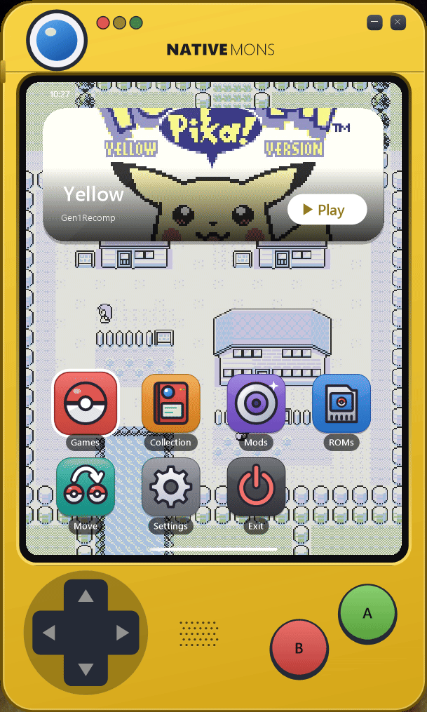
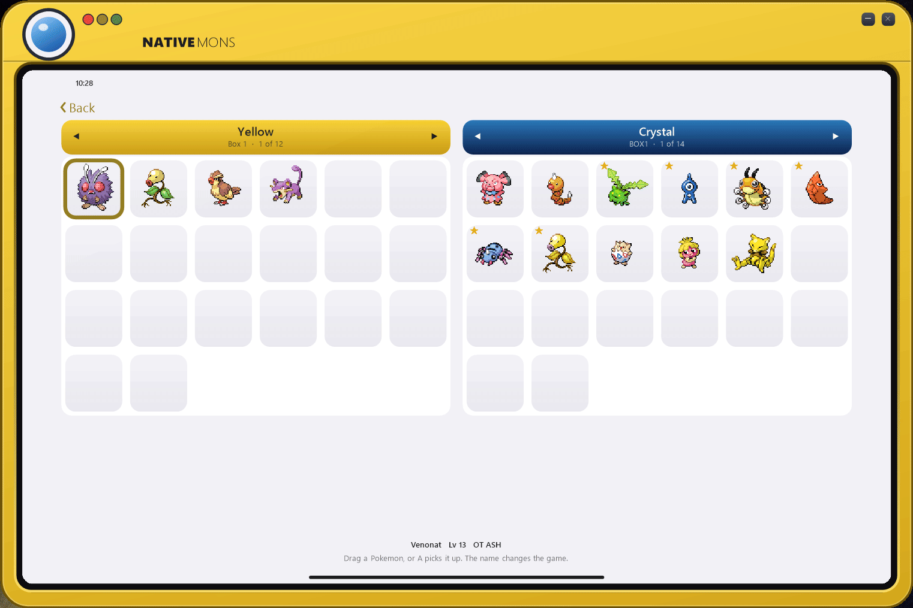

# My Collection and Move Pokemon

[Back to the README](../README.md)

Your Pokédex across every game, and moving Pokémon between games.

## My Collection

**My Collection** is one Pokédex built from the saves of every game the launcher finds:
- a **National** list from 001 to 1025;
- a list for **each region**, Kanto to Paldea (by the generation that introduced each Pokémon);
- your **counts by game**.

The lists read like the games' own: a Poké Ball by each Pokémon you've caught, an empty circle by one you've only
seen, and dashes in place of a name until you've seen it. Each region has its own colors and pattern, and the
Pokédex shows how much of each one you've caught.

**Caught** means the game's Pokédex says so, or the Pokémon is in a party or a box of yours. That includes Pokémon
you traded for or moved in with Move Pokemon, even where the game never recorded them.

**Romhacks and fan games** never count toward it. They're listed apart, each with a Pokédex of its own. Infinite
Fusion's is read from its own saves (species caught and seen, by National Dex number), with its fusions counted
separately. The launcher only reads the game's species list and saves, and never changes them.

**A caught Pokémon's entry** shows its picture, category, types, height, weight, base stats, abilities, and the
description from a game you caught it in, plus every game that has it.
- Types, base stats and abilities are shown as that game's generation had them (from PKHeX's tables): Clefairy is
  Normal in Crystal, Generation 1 has one Special stat, and abilities start with Generation 3.
- A badge for each game you have it in, in that game's colors, with a star where it's shiny.
- A gold star marks a shiny, and A switches between its shiny and normal pictures. Shinies are counted only while
  they're in a party or a box, because saves keep no record of the rest.

Entries come from [PokéAPI](https://pokeapi.co) the first time you open them, and are kept in
`state\pokedex-cache`. No game text comes with nativeMons.

## Move Pokemon

**Move Pokemon** shows your games' PC boxes the way Pokémon HOME does. The Pokédex unfolds into a tablet for it,
with two games side by side, each showing one box as a grid. Drag a Pokémon onto an empty slot in the other game to
move it; dropped back in its own game, it returns to its place.

| | Controller | Keyboard |
|---|---|---|
| Pick up, put down | A | Enter |
| Put it back | B | Escape |
| Switch between the two games | X | Tab or X |
| Change the box | LB / RB | Q / E |

With a controller, picking a Pokémon up jumps the cursor to the other game's nearest empty slot, and the bar at the
bottom shows the buttons. ◀ ▶ step through a game's boxes, and holding a dragged Pokémon over them turns the box too.
Selecting a game's name switches to another game.

- **Safe:** it uses [PKHeX.Core](https://github.com/kwsch/PKHeX), and both saves are backed up to
  `state\save-backups` first.
- **Blocked moves:** if a Pokémon knows attacks the other game doesn't have, you choose whether to delete or change
  them, then try again.
- **Limits:** a Pokémon that doesn't exist in the other game can't go there, and only Pokémon in the PC boxes can
  move, not your party.

**Between generations with no real transfer**, it uses the conversion code from
[OpenHome](https://github.com/andrewbenington/OpenHome) (GPL-3.0), and PKHeX checks the result. The Pokémon may be
flagged as not legal, and its form, ball and origin may change. Its original data is kept, and comes back when the
Pokémon returns to its own generation. This part is experimental: try a moved Pokémon in battle before relying on it.

**Open in PKHeX** and **Open in OpenHome** on a game's page open its save in your own copy of either.

## Pokémon pictures

Pictures come from [pogo.hails.app](https://pogo.hails.app) ([hailsDotGO](https://github.com/Hailey-Ross/hailsDotGO))
and are kept in `state\sprite-cache`, refreshed after 30 days. The launcher fetches a Pokémon along with its whole
evolution line, and works fine without them. **Settings > Download Pokedex** fetches every picture (Generations 1
to 5, normal and shiny) and every entry at once, for offline play. Run it again any time: it only fetches what's
missing.
